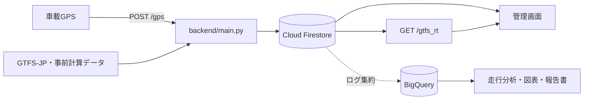

# 瑞穂町コミュニティバス バスロケーションシステム

1台のバスで実証した、GPS受信・運行便推定・遅延追跡・GTFS-Realtime配信のシステムです。現在の実装は **PythonのCloud Functions + Cloud Firestore + Firebase Hosting** です。

## 全体像



GPSから候補便を比較し、便を固定した後は進捗と遅延を追跡します。GTFS-Realtime取得時には便の再推定を行わず、保存済みの確定状態を読みます。詳しくは[現在のシステム構成](docs/system_overview.md)を参照してください。

## ディレクトリ

| 場所 | 内容 |
| --- | --- |
| `backend/` | 稼働対象のAPI、GTFS-JP、事前計算処理 |
| `frontend/` | 案内ページ、管理画面、地図データ・protobuf定義 |
| `analysis/` | 実証ログの分析スクリプト、SQL、保存済み集計結果 |
| `graphs/` | 実証の図表集。重複画像はここに集約 |
| `reports/` | v5報告書と、その生成スクリプト |
| `docs/` | 構成説明、詳細設計、要件・API・セットアップ資料 |
| `references/` | UIデザインの参考 |
| `logs/` | 過去の開発・実証記録 |

Firebaseは `firebase.json` の指定に従い、Functionsのソースに `backend/`、Hostingの公開先に `frontend/` を使います。プロジェクトの選択は `.firebaserc` にあります。

## 開発・分析

バックエンドの実行環境は `firebase.json` に合わせてPython 3.13を使用します。

```bash
python3.13 -m venv backend/venv
backend/venv/bin/python -m pip install -r backend/requirements.txt
backend/venv/bin/python -m pip check
```

Firestoreへの接続にはGoogle標準認証情報（ADC）が必要です。固定されている `firebase-admin==6.5.0` は、Firestoreエミュレーターを指定した場合も初期化時にADCを要求します。`API_KEY` を設定するとGPS受信で `X-API-KEY` を検証します。

管理画面には実証プロジェクトの接続先が設定されています。静的ファイルの配信だけではローカルDBへ自動接続しません。

分析には別途BigQueryへのアクセスと分析用のPython依存関係が必要です。[分析処理の案内](analysis/README.md)に入力・出力と実行時の注意をまとめています。生GPSはこのリポジトリには含まれておらず、Firestoreまたは集約先のBigQueryで確認します。

## 報告書の生成

Node.js環境で、リポジトリのルートから実行します。

```bash
npm ci
npm run report
```

`graphs/` の画像から `reports/瑞穂町バスロケPoC報告書_v5.docx` を生成します。出力先を変える場合は `npm run report -- /path/to/report.docx` を指定します。既存の報告書を保持して試す場合は別の出力先を指定してください。

## 資料

- [東京AIハッカソン2026・参加意図とAI化構想](docs/tokyo_ai_hackathon_2026.md)

- [現在のシステム構成・データ保存先](docs/system_overview.md)
- [便固定モデルv3.3の詳細設計](docs/new_architecture.md)
- [実証時の要件定義](docs/requirements_v1.1.md)
- [初期API仕様](docs/api-spec.md)・[Firebase構築時の資料](docs/firebase_setup.md)
- [図表一覧と分析結果](graphs/README.md)
- [v5報告書](reports/瑞穂町バスロケPoC報告書_v5.docx)

初期資料には当時の仕様・手順が含まれます。現在の動作を確認する際は、現行コードと詳細設計を優先してください。
