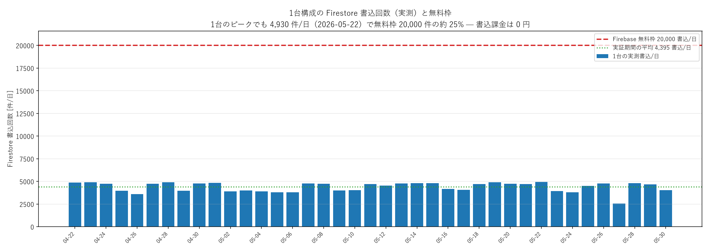
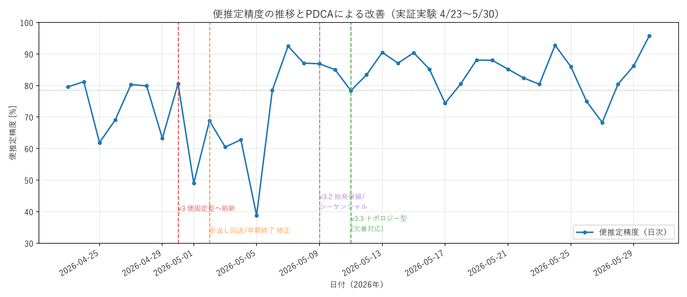
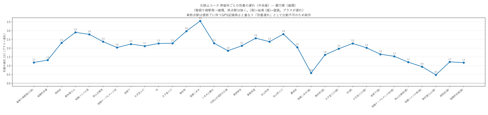
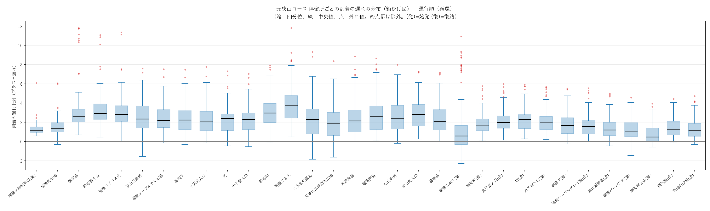
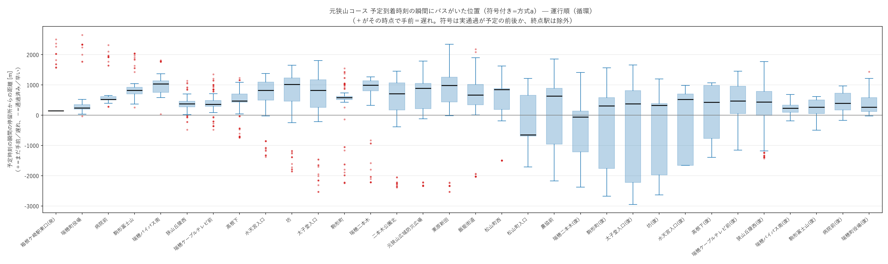
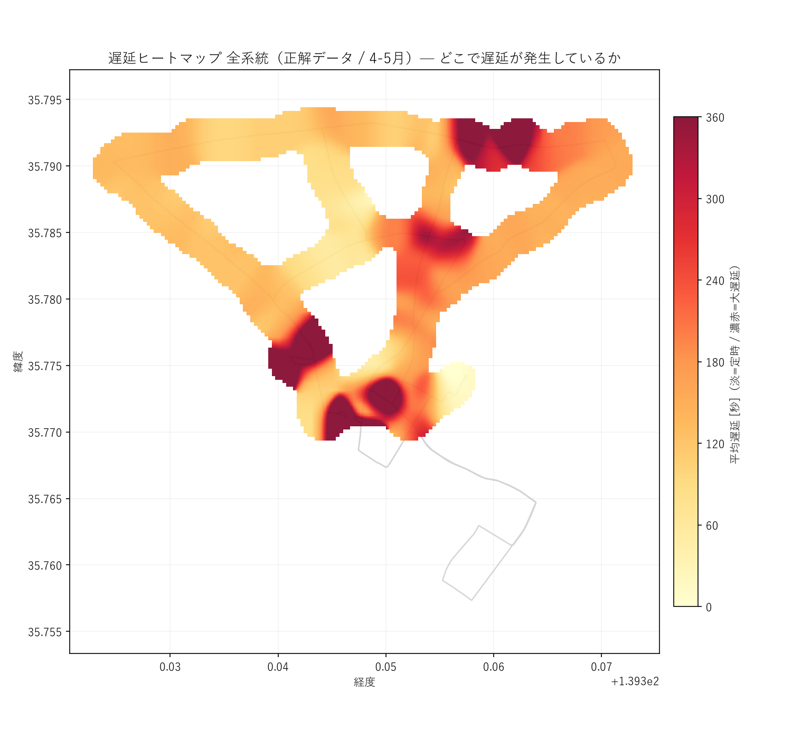

# 瑞穂町コミュニティバス バスロケPoC — 分析結果ビジュアル一覧

実証実験（2026/04/23〜05/30、1台構成 Raspberry Pi 4 + Firebase）で収集した全GPSログを
BigQuery に集約し、役場提出報告書に向けて分析した結果の図表インデックスです。

- **正解データ (gt)** = 走行後に後知恵で作った「正解の便推定」（`ground_truth`）
- **運行データ (op)** = 実証当時にシステムがリアルタイムに出力していた推定・遅延
- 対象系統: **元狭山コース(1) / 元狭山・長岡コース(2) / ふれあいセンターコース(4)**
  （石畑・殿ケ谷(3)・箱根ケ崎駅東口循環(5)は信頼できる運行データが乏しく参考扱い）
- 全系統とも **箱根ケ崎駅を発着する循環路線**。往路→折返し→復路の順にX軸へ並べ、
  復路の同名停留所は「(復)」、始発は「(発)」、終点は「(着)」で区別。

> 生成スクリプトは `../analysis/*.py`、集計CSVは `../analysis/out/**/*.csv`。

---

## ① コスト

Firestore の書込回数を実ログで集計。**1台構成なら無料枠内で運用費0円**、約4台までは従量課金なし。

- `cost_firestore_writes_by_day.png` — 日別書込回数と無料枠（20,000/日）ライン
- 平均4,395件/日・ピーク4,930件/日（無料枠の約25%）
- 残るコスト要素（機材費・SIM・Cloud Run実費）は実費入力待ち

---

## ② 便推定精度 × 開発PDCA

後知恵の正解便と当時のリアルタイム推定を点単位で照合。アルゴリズム改修の履歴と重ねて表示。

- `figures_fig1_accuracy_pdca.png` — 日別精度とv3/v3.2/v3.3改修の対応
- 全期間 **79.4%**。便固定v3導入直後(5/1-5/5)に一度低下→修正後 **85〜93%** に回復・安定

---

## ③ 運行示唆

### 3-1. 停留所ごとの到着遅れ（折れ線・正解データ）

停留所を運行順に並べ、全便を集約した到着遅れ[分]。**往路で遅れが蓄積→復路で回復**する循環の実態。

| 系統 | 中央値 | 平均値 | 終点駅を除いた版 |
|---|---|---|---|
| 元狭山(1) | `reliability_delay_by_stop_route1_median.png` | `..._mean.png` | `..._median_noterm.png` / `..._mean_noterm.png` |
| 元狭山・長岡(2) | `reliability_delay_by_stop_route2_median.png` | `..._mean.png` | `..._noterm.png` |
| ふれあい(4) | `reliability_delay_by_stop_route4_median.png` | `..._mean.png` | `..._noterm.png` |
| 石畑・殿ケ谷(3)※参考 | `reliability_delay_by_stop_route3_median.png` | `..._mean.png` | — |

- **終点(着)は要注意**: バスが終点駅に到達した瞬間に便が終了しGPS記録が止まるため、
  「到着遅れ」としては −6分など見かけの早着が出る。`_noterm` 版は終点駅を除外して比較しやすくしたもの。

### 3-2. 到着遅れの分布（箱ひげ図）

停留所ごとの四分位・ひげ・外れ値。ばらつき（定時性の良し悪し）と検出エラーの残存を点検できる。

- `reliability_delay_boxplot_route{1,2,4}.png`（終点込み）
- `reliability_delay_boxplot_route{1,2,4}_noterm.png`（終点除外）

### 3-3. 予定到着時刻の瞬間にバスがいた位置

「時刻表の到着時刻ちょうどにバスが停留所からどれだけ離れていたか」を距離で見る補助分析。

- 方式a（符号付き: ＋=まだ手前/遅れ、−=通過済み/早い）: `reliability_pos_at_sched_route{1,2,4}_a{,_noterm}.png`
- 方式c（絶対距離）: `reliability_pos_at_sched_route{1,2,4}_c{,_noterm}.png`
- ルート位置(0=始発,1=終点)×遅延: `reliability_delay_by_position_{median,mean}.png`

### 3-4. 遅延の地理分布（ヒートマップ・路線図）

- **遅延の大きさ**（30mセル・中央値をぼかしKDE風）: `heatmap_{gt,op}_{all,route1,route2,route4}.png`
- **5分/10分以上の遅延発生率**: `late_heatmap_{gt,op}_{5min,10min}.png`
  （10分以上は南側終端の折返し付近2停留所に集中）
- **路線グラデーション**（進行方向で往復を分離、緑→黄→赤）:
  `route_delay_{gt,op}_{full,stable}_route{1,2,4}.png`
- **遅延地点マップ**: `late_delay_{gt,op}_route{1,2,4}.png`、`figures_fig2_delay_map.png`

### 3-5. 時間帯・天候・曜日

- 時間帯別遅延: `figures_fig3_delay_by_hour.png`（午後〜夕方に遅延蓄積）
- 天候・曜日別: `figures_fig4_weather_weekday.png`（安定期は雨天でも悪化なし＝雨に頑健）

### 3-6. 体感不安定度（「予定通り来ない」の検証）

- `reliability_fig_pos_delay.png` — ルート位置×遅延（余裕ダイヤ=パディングの検証）
- `reliability_fig_top_unreliable.png` — 予測困難な停留所ランキング
- `reliability_fig_unreliability_map.png` — 不安定度マップ

---

## 主な発見（要約）

- **遅延は日中に蓄積**: 朝は中央値95秒、午後〜夕方でmean 400〜500秒。系統1が最も遅れやすい。
- **遅れやすい地点**: 瑞穂ケーブルテレビ前・駒形富士山・瑞穂町役場・瑞穂バイパス南 等。
- **GPS品質は良好**: 全体平均33m・>50mは6.6%のみ。丘陵地（ふれあいセンター等）でやや悪化。
- **雨に頑健**: 安定期(5/10-)では雨天でも精度・GPS・遅延に実質差なし。
- **ダイヤはパディング設計**: 中間停留所は恒常的に2〜3分遅れて見えるが終点で吸収。終点手前区間は
  徒歩推定を超える所要時間で、地図アプリが「一つ手前で降りて歩け」と判定する理由を定量裏付け。

## 補足

- 循環路線の投影バグ修正の経緯は `../analysis/stop_events.py` 冒頭コメント参照。
- 図の再生成: `cd analysis && ../.venv/Scripts/python.exe <script>.py`。
- 集計CSV（数値の裏付け）は `../analysis/out/` に req1〜req5・insights_*・stop_reliability 等。
